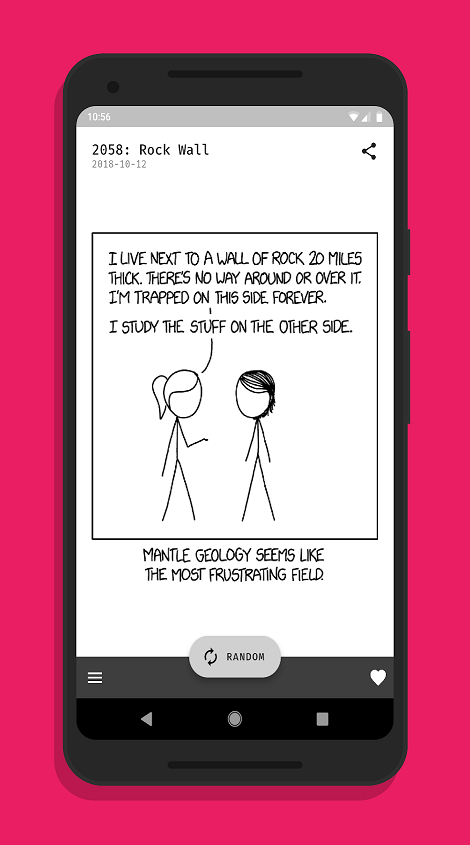
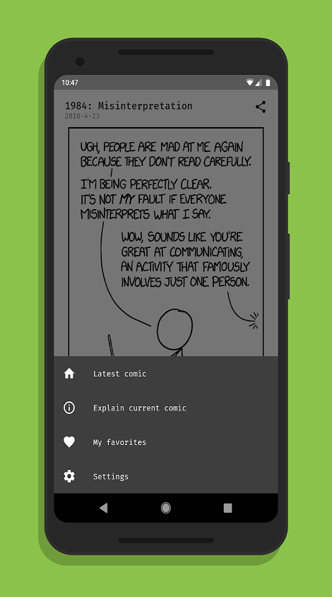
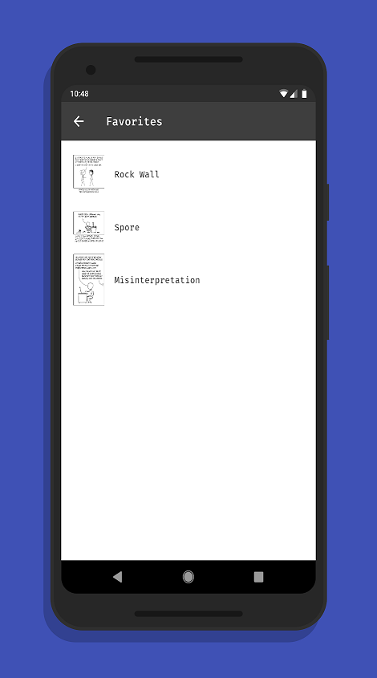
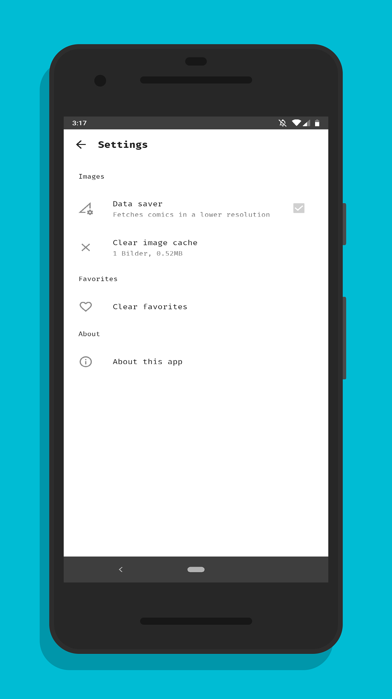

# xkcdViewer

[](https://github.com/wakahuula/xkcdViewer/actions/workflows/android.yml)
[](https://github.com/wakahuula/xkcdViewer/stargazers)
[](https://github.com/wakahuula/xkcdViewer/network)
[](https://github.com/wakahuula/xkcdViewer/issues)
[](https://github.com/wakahuula/xkcdViewer/blob/master/LICENSE)


xkcdViewer is a comic viewer for [xkcd](https://xkcd.com), being migrated from Flutter to Kotlin Multiplatform and Compose Multiplatform. The `compose-migration` branch contains the Android app with shared Material 3 UI and application logic. It builds without a Flutter SDK.

Android requires API 23 or later. iOS has not been migrated; the files in `ios/` are historical references, not a working Compose app. Flutter sources are retained until Android acceptance is complete. Release and in-place update verification are still outstanding.

The screenshots below show the original Flutter app, not the new Compose UI.

   

## Features
👀 Get the latest xkcd comic

📖 Randomly browse comics

🔖 Add comics to your favorites

💬 Swipe up for alt text

📲 Share the fun

🌍 Read the explanation on explainxkcd

📶 Data saver option

## Build and test Android

Open the repository root in Android Studio, not the `android/` subdirectory. Use JDK 21 for both `JAVA_HOME` and Android Studio's Gradle JDK. Install Android SDK Platform 37.0 and Build Tools 36.0.0. Point `ANDROID_HOME` to your SDK, or set `sdk.dir` in an untracked root `local.properties` file.

From PowerShell in the repository root:

```powershell
.\gradlew.bat -p build-logic test
.\gradlew.bat :shared:verifyLegacyResources :shared:jvmTest :app:assembleDebug :app:lintDebug
```

On macOS/Linux, use `./gradlew` instead. Run the build-logic and root builds sequentially; both compile the same included build. The debug APK is written to `android/app/build/outputs/apk/debug/app-debug.apk`.

Device tests run separately on a dedicated emulator or test device:

```powershell
$env:ANDROID_SERIAL = '<test-device-serial>'
.\gradlew.bat :app:connectedDebugAndroidTest
```

The GitHub Actions workflow runs build-logic tests, shared JVM tests, resource checks, debug/test APK compilation and lint. It does not run device tests or verify a release update. It requires no signing secrets.

Release builds require the original local `android/key.properties`, a compatible signing key, and confirmed published/new version numbers. Missing configuration deliberately blocks release builds; it never falls back to debug signing. See [release and update verification](docs/migration/android-update-verification.md) and the [current acceptance report](docs/migration/android-acceptance-2026-10-09.md).

## Translations

The original JSON files in `assets/locale/` remain the source for translation contributions. All nine languages are preserved: German, English, Spanish, French, Hungarian, Japanese, Portuguese, Russian and Ukrainian. Gradle generates Compose resources from these files; do not edit generated files under `build/`.

New UI/error messages are in `shared/src/commonMain/composeResources/values/migration.xml` and currently fall back to English where no translation exists. Existing contributor data, fonts, icons and credits are retained.

[](https://apt.izzysoft.de/fdroid/index/apk/de.stoupas.xkcd)

<!--
[](https://play.google.com/store/apps/details?id=de.stoupas.xkcd)

Google Play and the Google Play logo are trademarks of Google LLC.
-->

The comics displayed in this app are licensed under a Creative Commons Attribution-NonCommercial 2.5 License. Visit [xkcd](https://xkcd.com) for additional information.

## Contributors
Contributions are always welcome! 👏

[](https://sourcerer.io/fame/wakahuula/wakahuula/xkcdViewer/links/0)
[](https://sourcerer.io/fame/wakahuula/wakahuula/xkcdViewer/links/1)
[](https://sourcerer.io/fame/wakahuula/wakahuula/xkcdViewer/links/2)
[](https://sourcerer.io/fame/wakahuula/wakahuula/xkcdViewer/links/3)
[](https://sourcerer.io/fame/wakahuula/wakahuula/xkcdViewer/links/4)
[](https://sourcerer.io/fame/wakahuula/wakahuula/xkcdViewer/links/5)
[](https://sourcerer.io/fame/wakahuula/wakahuula/xkcdViewer/links/6)
[](https://sourcerer.io/fame/wakahuula/wakahuula/xkcdViewer/links/7)
